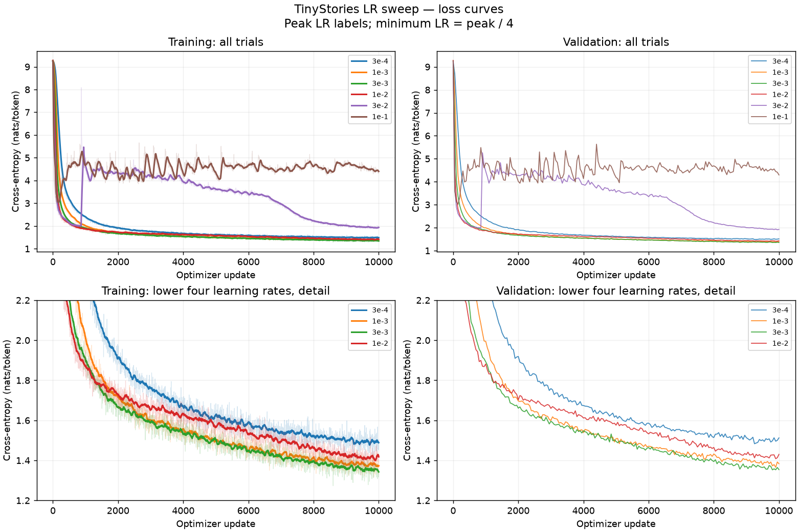
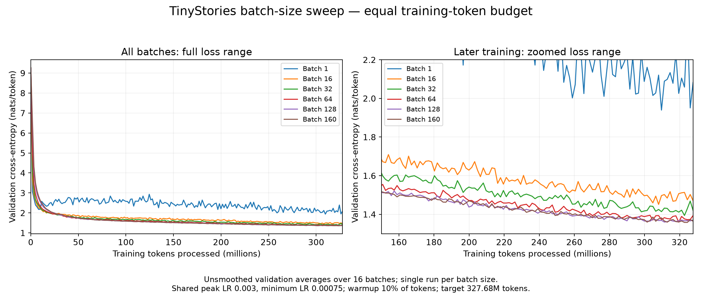
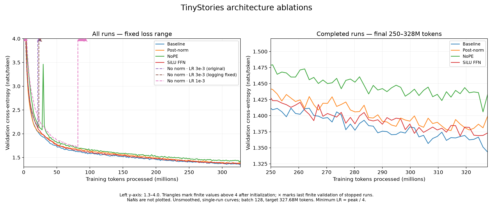

# CS336 Assignment 1 — TinyStories language model

My implementation of [Stanford CS336 Assignment 1: Basics](https://github.com/stanford-cs336/assignment1-basics): BPE tokenization, training a Transformer language model in Pytorch on TinyStories, and sampling from the trained model.

Tokenizer, Transformer, AdamW, training utils, checkpointing, and generation implemented without LLM assistance.
Learning-rate and batch-size sweeps, and architecture ablations conducted on Modal, using YAML configs and W&B logging.

Best observed validation cross-entropy: **1.3434**, below the assignment target of 1.45.
Results are single-run comparisons, not multi-seed estimates.

See the [assignment handout](cs336_assignment1_basics.pdf) for requirements and the upstream repository for setup and data instructions. Run tests with `uv run pytest`.

## LR sweep

[LR sweep charts (PDF)](reports/lr-sweep/lr-sweep.pdf)



Training curves show a trailing average of 16 samples (about 80 updates).
Validation averages 16 batches at a fixed checkpoint.

**Finding:** Peak LR `3e-3` gave the best final loss, with unstable learning at higher LR or worse final loss for lower LR.

Baseline: 4 layers, width 512, FFN 1344, 16 heads, context 256, vocabulary 10,000;
batch 128, 10,000 updates (327.68M tokens), float32 on A10. All trials use 1,000
warmup updates and cosine decay through update 10,000, with minimum LR equal to
one quarter of peak LR. AdamW uses betas `(0.9, 0.999)`, weight decay `0.1`, and
global gradient clipping at L2 norm `1.0`.

| Peak LR | Minimum LR | Final train CE | Final validation CE |
| --- | --- | --- | --- |
| 3e-4 | 7.5e-5 | 1.5052 | 1.5124 |
| 1e-3 | 2.5e-4 | 1.3722 | 1.3834 |
| 3e-3 | 7.5e-4 | 1.3314 | 1.3540 |
| 1e-2 | 2.5e-3 | 1.3913 | 1.4300 |
| 3e-2 | 7.5e-3 | 1.9955 | 1.9233 |
| 1e-1 | 2.5e-2 | 4.3203 | 4.2956 |

Live results are in the [W&B project](https://wandb.ai/pgab/cs336-basics).

## Batch-size sweep

[Batch-size sweep chart (PDF)](reports/batchsize-sweep/validation-vs-tokens.pdf)



**Finding:** At equal token budgets and a fixed LR, batches 128 and 160 performed similarly and best. Smaller batches finished with higher loss, larger batches CUDA OOMed.

Each run processes 327.68M tokens, with LR `3e-3 → 7.5e-4` and 10% warmup.
LR wasn't retuned per batch size.

## Architecture ablations

[Architecture ablation chart (PDF)](reports/architecture-ablation/validation-vs-tokens.pdf)



**Finding:** The baseline had the lowest final loss. Removing all layer norms (RMSNorm) diverged, even at lower tested LR. Post-norm, NoPE, and ungated SiLU finished with higher losses.

| Architecture | Final validation CE |
| --- | ---: |
| Baseline | 1.3434 |
| Post-norm | 1.3992 |
| NoPE | 1.4329 |
| SiLU FFN (`d_ff: 2048`) | 1.3731 |

## TinyStories generation

Checkpoint: `tinystories-batchsize/batch-size-128`; temperature `0.2`, top-p `0.9`.

**Prompt:** `The crab taught`

**Generated continuation:**

```text
 the little fish how to swim fast. The little fish was happy. The crab was happy too. They became good friends. The moral of the story is: helping others can make you happy too.
<|endoftext|>
```

```bash
uv run modal shell modal_pilot.py::pilot --no-pty --cmd \
"/.uv/.venv/bin/python /workspace/generation.py \
  --rundir /runs/tinystories-batchsize/batch-size-128 \
  --data-dir /data/encoding \
  --device cuda \
  --prompt 'The crab taught' \
  --max-tokens 256 \
  --temperature 0.2 \
  --top-p 0.9"
```
